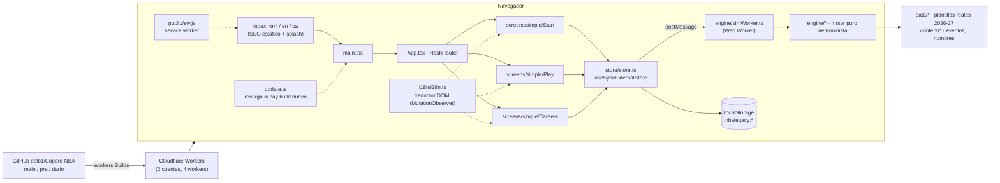
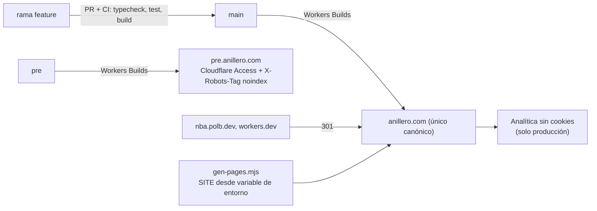

# 01 · Inventario y arquitectura

**Código analizado:** rama `origin/pre` (`f3925bf`, 23-10-2026), revisada en una copia de trabajo temporal y de solo lectura.

**Qué se excluyó y por qué:**
- `node_modules/`: dependencias de terceros.
- `dist/`: generado por el build.
- `en/index.html` y `ca/index.html`: los genera `scripts/gen-pages.mjs` y están ignorados por Git.
- Binarios de `public/`: 168 escudos, 200 banderas, 30 fotos e iconos. Solo se ha medido su tamaño.

## 1. Stack real (verificado en `package.json` y en el código)

| Pieza | Versión | Uso |
|---|---|---|
| React + React DOM | 18.3.1 | Interfaz |
| react-router-dom | 6.26.2 | `HashRouter`: rutas `#/`, `#/start`, `#/play` y `#/careers` (`src/App.tsx:55-61`) |
| TypeScript | 5.6.3 | Modo estricto, sin errores (`tsc -b`) |
| Vite | 5.4.9 | Build multipágina: `/`, `/en/`, `/ca/` (`vite.config.ts`) |
| Vitest | 2.1.3 | 41 archivos y 239 tests |
| Cloudflare Workers (solo static assets) | `wrangler.jsonc` | Hosting, sin código de servidor |

- **Backend:** no hay. Tampoco APIs propias ni variables de entorno; no existe `.env` ni `.env.example`.
- **Datos externos:**
  - En ejecución: logos de la NBA desde `cdn.nba.com` y fuentes de Google Fonts.
  - En desarrollo: `scripts/update-nba-roster.mjs` descarga plantillas de ESPN.

## 2. Arquitectura actual

### Flujo de ejecución
1. `index.html` muestra un *splash* inline y el contenido SEO del pie (`<footer id="about">`).
2. `main.tsx` monta React, registra el service worker y arranca `watchForUpdates()`.
3. Al pulsar **Empezar carrera** (`Start.tsx`), el store crea la carrera (`engine/career.ts`) y la simulación avanza por bloques en un **Web Worker** (`simWorker.ts` → `api.ts` → `flow.ts` / `season.ts` / `offseason.ts`).
4. Cuando el motor necesita una decisión, la UI la muestra (`EventInline.tsx` o minijuegos en `ui/minigames/*`). La respuesta vuelve al motor como `(career, input) → career`.
5. Cada cambio se guarda en `localStorage` (`store.ts: saveCareer`). Solo existe una ranura: la carrera nueva sustituye a la anterior, y las terminadas pasan al historial.

### Separación de capas
La separación entre UI y lógica es **buena**:
- `engine/` no importa nada de React.
- No usa `Math.random`: todo pasa por `rngFor(seed, …)`.
- Los eventos son datos declarativos en `content/events.ts`.

**Excepciones:**
- `store/store.ts` mezcla persistencia, formato de presentación (`metaFor` compone textos en castellano: «años», «OVR»…) y orquestación del worker.
- `screens/simple/Play.tsx` (860 líneas) concentra muchas responsabilidades.

### Gestión de errores
- `ui/ErrorBoundary.tsx` permite descargar la partida si la app se rompe.
- `read()` y `write()` de `localStorage` capturan las excepciones. Si se llena la cuota, `saveCareer` devuelve `false`, pero no se ha encontrado aviso al usuario. Revisión estática; no se ha forzado el error.

### Build y despliegue
- `npm run build` = `gen-pages.mjs` → `tsc -b` → `vite build`.
- **Cloudflare Workers Builds** escucha GitHub. No hay GitHub Actions.
- Mapa real, visto en el panel de Cloudflare el 22-10-2026:

| Cuenta Cloudflare | Worker | Rama | Dominios |
|---|---|---|---|
| Anillero-Project | `copero-x-nba` | `main` | anillero.com, copero-x-nba.anillero-project.workers.dev |
| Anillero-Project | `copero-nba-pre` | `pre` | pre.anillero.com, copero-nba-pre.anillero-project.workers.dev |
| Personal | `copero-x-nba` | `main` | nba.polb.dev (+1 ruta) |
| Personal | `copero-nba-pre` | `pre` | pre-nba.polb.dev (+1 ruta) |

## 3. Arquitectura recomendada

No hace falta migrar de tecnología. Vite + React estático encaja con un juego sin backend. Los cambios recomendados atacan problemas concretos:

## 4. Inventario por módulo

Se resumen los ~150 archivos propios por grupo y se detallan los que tienen hallazgos.

**Estados:** C = completo · P = parcial · E = experimental · O = obsoleto · ? = desconocido.

**Prioridades:** P0 = urgente · P1 = alta · P2 = media · P3 = baja.

| Ruta | Tipo | Función | Estado | Dependencias | Problemas | Prioridad |
|---|---|---|---|---|---|---|
| `index.html` | Página/SEO | HTML de entrada en ES, metadatos, JSON-LD, splash, guía rastreable en el pie | C | — | Canonical, hreflang y OG apuntan a `nba.polb.dev` (l. 15-19, 23, 35-36). Marca «NBA Legacy». | **P0** |
| `scripts/gen-pages.mjs` | Script de build | Genera `/en/` y `/ca/` con metadatos traducidos | C | `index.html` | `SITE = 'https://nba.polb.dev'` fijo (l. 5): no hay forma de distinguir entornos | **P0** |
| `public/sitemap.xml`, `public/robots.txt` | SEO | 3 URLs con hreflang y referencia al sitemap | C | — | Dominio antiguo en todas las URLs | **P0** |
| `public/sw.js` | PWA | Caché: red primero para HTML, caché primero para assets | C | — | Correcto. Sin versionado más allá de `nbalegacy-v1` (aceptable porque los assets llevan hash). | P3 |
| `public/manifest.webmanifest` | PWA | Instalación | C | iconos | Sin capturas ni `id`. El icono `maskable` es el mismo que el `any`. | P3 |
| `public/404.html` | Página | Página 404 del Worker | C | — | — | P3 |
| `public/crests/` (168 PNG, 7,8 MB) | Recurso | Escudos de clubes (Wikipedia) | C | — | Algunos de 130-150 KB sin optimizar. Riesgo de marcas. | P2 |
| `public/stock/` (30 JPG, 2,4 MB) | Recurso | Fotos de Unsplash | C | `docs/CREDITS.md` | Algunas de 150-210 KB | P3 |
| `head-desk.png`, `head-phone.png` (raíz) | Recurso | Capturas sueltas versionadas | O | — | Ruido en la raíz del repo | P3 |
| `src/main.tsx`, `src/App.tsx` | Arranque y rutas | Montaje, SW, rutas hash | C | router | `Gallery` solo en desarrollo (bien). Las rutas antiguas redirigen a `/`. | P3 |
| `src/update.ts` | Utilidad | Recarga pestañas abiertas cuando hay un build nuevo | C | — | Depende del nombre `assets/main-*.js` | P3 |
| `src/store/store.ts` (459 l.) | Estado y persistencia | Ranura única, historial, logros, rachas, worker | C | engine | Bug en `exportCareer`: `/s+/g` en vez de `/\s+/g` (l. ~115). `migrate()` devuelve `null`, así que **un cambio de `SAVE_VERSION` borra partidas sin aviso**. Mezcla textos de UI. | **P1** |
| `src/engine/*` (~35 archivos) | Lógica de negocio | Motor puro: liga, calendario, partidos, temporada, draft, mercado, finanzas, lesiones, premios, legado, minijuegos | C | `data/`, `content/` | `offseason.ts` (907 l.) y `flow.ts` (468 l.) son grandes. `docs/ARCHITECTURE.md` cita `daily.ts`, que ya no existe. | P2 |
| `src/engine/simWorker.ts` | Worker | Simula fuera del hilo principal | C | engine | 164 kB sin comprimir | P3 |
| `src/engine/standing.test.ts` | Test | Test fuera de `__tests__/` | C | — | Ubicación incoherente | P3 |
| `src/content/events.ts` (937 l., ~96 eventos) | Datos | Eventos declarativos | C | engine | Textos solo en ES; se traducen después en el DOM | P2 |
| `src/data/nbaRoster2026.json` (444 KB) | Datos | Plantillas reales 2026-27 | C | — | Va dentro del bundle principal (768 kB) | P2 |
| `src/data/clubs.ts`, `logos.ts`, `clubLogos.ts`, `teams.ts`, `countries.ts` | Datos | Clubes, logos (CDN de la NBA), países | C | — | Dependencia en ejecución de `cdn.nba.com` | P2 |
| `src/i18n/i18n.ts`, `en.ts` (1.581 l.), `ca.ts` (1.503 l.) | i18n | Traducción en el DOM con diccionarios indexados por el texto español | C | — | Frágil: cambiar un texto en ES rompe su traducción sin que falle ningún test, salvo los de `i18n/__tests__`. ~1.570 entradas. | P2 |
| `src/screens/simple/Play.tsx` (860 l.) | Pantalla | Juego principal | C | store, ui | Componente demasiado grande: pestañas, banners, modal de retirada, tablas… | P2 |
| `src/screens/simple/Start.tsx`, `Careers.tsx`, `EventInline.tsx` | Pantallas | Creación, historial, decisiones | C | store | — | P3 |
| `src/screens/Gallery.tsx` | Pantalla de desarrollo | Galería de arte | E | — | Solo en `DEV` | P3 |
| `src/ui/minigames/*`, `Minigame.tsx`, `ShotMeter.tsx` | UI | Minijuegos de tiro, reacción, potencia y objetivo | C/E | pointer | Muy recientes (rama `dario`); poco tiempo en producción | P2 |
| `src/ui/card.ts`, `download.ts` | UI | Tarjeta PNG de carrera y compartir | C | canvas | — | P3 |
| `src/ui/Scene.tsx` (588 l.), `ui/art/*` | UI | Ilustraciones y fotos de escena | C | stock | — | P3 |
| `src/ui/flagColors.ts` | UI | Colores de camiseta según la bandera | C | canvas | — | P3 |
| `src/styles.css`, `src/simple.css` (900 l.) | Estilos | Estilos globales | C | — | `styles.css` es en parte heredado de la UI anterior. Hay que revisar si quedan selectores muertos (no medido). | P3 |
| `scripts/update-nba-roster.mjs` (980 l.) | Script | Descarga plantillas y estadísticas de ESPN | C | red | Ruta `/opt/homebrew/bin/node` en el comentario (macOS). Revisar los términos de uso de ESPN. | P2 |
| `docs/*.md` | Documentación | Arquitectura, diseño, investigación, roadmap y créditos | P | — | Desfasada: el ROADMAP marca como «Hecho» el desafío diario, «22 pantallas» e importar JSON, que ya no existen en la UI | P2 |
| `README.md` | Documentación | Presentación | P | — | Sin URL de producción ni licencia | P2 |
| `wrangler.jsonc` | Despliegue | Worker de assets estáticos | C | — | Sin `routes` ni entornos; los dominios viven solo en el panel | P1 |
| `.claude/launch.json` | Herramientas | Servidor de desarrollo para Claude Code | C | — | — | P3 |
| `.gitignore` | Configuración | Ignora `node_modules`, `dist`, logs, `en/` y `ca/` | C | — | Falta `.wrangler/` (existe en local) | P3 |

## 5. Búsquedas específicas

| Búsqueda | Resultado |
|---|---|
| TODO / FIXME / HACK | **0** en el código fuente |
| `console.*` fuera de los tests | 1 aparición |
| `dangerouslySetInnerHTML`, `innerHTML`, `eval`, `new Function` | **0** |
| Archivos duplicados | No se encontraron duplicados de código. `styles.css` y `simple.css` se solapan parcialmente (no medido). |
| Componentes desconectados | La pantalla `Gallery` (solo en desarrollo, intencionado). El **reto diario**: el motor tiene `dailyKey` y `EVENT_RATE.daily`, pero no hay ninguna entrada en la UI. |
| Rutas sin uso | Las antiguas («detalle», «daily», «saves», «settings») redirigen a `/` (`App.tsx:60`) |
| Dependencias sin uso | Ninguna: las 3 de producción se usan |
| Datos ficticios presentados como reales | Las clases del draft, los entrenadores y los agentes son generados; las plantillas NBA 2026-27 son reales. Está documentado en el ROADMAP. |
| Errores de tipado | 0 |
